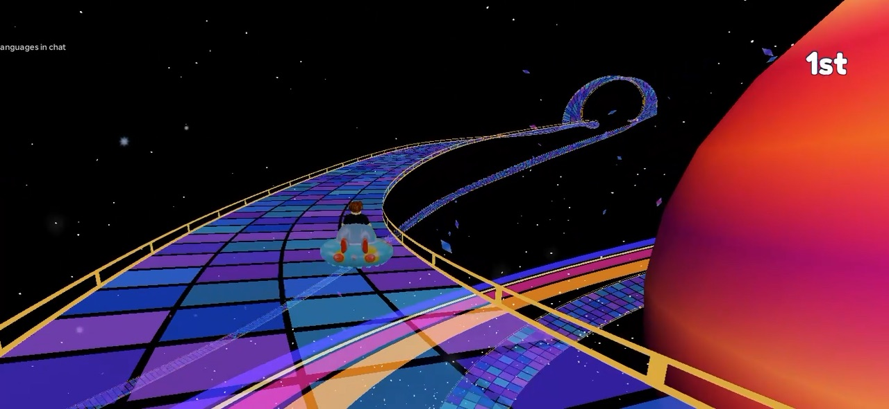

# Roblox Car: 우주 레이스

우주에 뜬 도로에서 컴퓨터 차와 3바퀴를 겨루는 로블록스 자동차 경주 게임입니다.
"아바타톤 로블록스편" 멘토 지원용 데모로 만들었습니다. 지원 조건과 행사 내용은 [`docs/context.md`](docs/context.md)에 있습니다.

AI(Claude Code)로 코드를 짜고, 차 모델은 VARCO 3D로 만들었습니다.
코스는 고리 행성을 감아 도는 "별빛 다리" 하나입니다.
도로는 오르막과 내리막을 지나고, 한 번은 360도 뒤집히는 코르크스크루를 통과합니다. 차는 뒤집혀도 도로에 붙어서 달립니다.

## 플레이 영상

[](docs/demo.mp4)

이미지를 누르면 72초짜리 플레이 영상([`docs/demo.mp4`](docs/demo.mp4))이 열립니다. 원본 녹화(97.6MB)를 1280x592, 2.5Mbps H.264로 줄여서 22.6MB입니다. 소리는 없습니다.

## 플레이하기

1. Roblox Studio에서 `Place1.rbxl`을 엽니다.
2. **Home** 탭에서 **Play**를 누릅니다.
3. 게임 화면을 한 번 클릭해서 키 입력이 게임으로 가게 합니다.
4. 3, 2, 1, GO! 다음에 출발합니다.

| 키 | 동작 |
| --- | --- |
| W 또는 ↑ | 가속 |
| S 또는 ↓ | 브레이크, 멈춘 상태에서는 후진 |
| A 또는 ← | 왼쪽으로 꺾기 |
| D 또는 → | 오른쪽으로 꺾기 |

왼쪽 위에 몇 바퀴째인지, 오른쪽 위에 현재 등수가 나옵니다.
3바퀴를 다 돌면 "1등!" 또는 "2등"이 뜹니다.
내 아바타는 하늘색 호버카 조종석에 앉아서 달립니다. 컴퓨터 차에는 주황 옷을 입은 아바타가 탑니다.

### 코스: 별빛 다리

| 길 모양 | 한 바퀴 | 높이 | 도로와 하늘 |
| --- | --- | --- | --- |
| 고리 행성을 1과 1/4바퀴 감아 오르는 나선, 출구 직선의 코르크스크루, 긴 내리막 | 6991 스터드, 컴퓨터 차 70.3초 | 59~346 | 은은하게 빛나는 틈이 있는 크리스털 타일 다리와 금빛 난간, 밝게 빛나는 줄무늬 가스 행성과 색 고리, 떠다니는 크리스털 |

한 바퀴 길이와 컴퓨터 차 시간은 `tests/Track.spec.luau`의 `INFO` 줄에 나옵니다. 높이의 최댓값은 코르크스크루 꼭대기입니다.

도로는 안개등처럼 은은하게 빛납니다. 아이와 부모가 한 판 내내 편하게 볼 수 있도록, 잘 보이지만 눈부시지 않은 밝기에 맞췄습니다.
도로 타일은 스스로 빛나는 네온 재질이지만 중간 밝기의 차분한 색이라 하얗게 날아가지 않고, 반투명해서 아래의 별이 비쳐 보입니다. 난간과 기둥도 네온이고 차분한 금색입니다.
행성과 고리는 밝은 색의 네온입니다. 화면 전체로 빛을 번지게 하는 Bloom과 도로를 가로지르던 흰 줄은 쓰지 않습니다.

## 개발 환경

| 도구 | 하는 일 |
| --- | --- |
| Roblox Studio | 게임 실행과 편집. 맵 파일은 `Place1.rbxl` 하나입니다. |
| [Rojo](https://rojo.space) 7.7 | `src/` 폴더의 코드를 Studio로 실시간 동기화합니다. 매핑은 `default.project.json`에 있습니다. |
| Roblox Studio MCP | AI가 Studio에서 코드를 실행하고 플레이 테스트를 돌립니다. |
| VARCO 3D MCP | AI가 텍스트로 이미지와 3D 모델을 만듭니다. |
| uv | 메시 정리 스크립트를 Python 3.12로 실행합니다. |

MCP 서버 설정은 `.mcp.json`에 있습니다.

코드를 고칠 때는 다음 순서로 합니다.

1. 터미널에서 `rojo serve`를 실행합니다.
2. Studio의 Rojo 플러그인에서 **Connect**를 누릅니다.
3. `src/` 아래 파일을 저장하면 Studio에 바로 반영됩니다.

Rojo는 `src/`와 연결된 세 폴더만 덮어씁니다. Studio에서 직접 넣은 차 모델 같은 것은 `Place1.rbxl`에 저장되고 Rojo가 건드리지 않습니다.

## 구조

레이스는 플레이어 컴퓨터(클라이언트)에서 돕니다. 서버 스크립트는 아바타를 불러오는 일만 합니다.

```
src/
├── shared/                 (ReplicatedStorage.Shared)
│   ├── Track.luau          꼭짓점 목록 → 도로 프레임, 트랙 위 좌표 → 월드 위치
│   ├── Course.luau         별빛 다리의 꼭짓점과 코르크스크루
│   ├── CarPhysics.luau     차 한 대를 1/60초만큼 움직이는 순수 함수
│   ├── AiDriver.luau       컴퓨터 차의 핸들과 가속 결정
│   └── FrameClock.luau     화면 프레임 시간을 1/60초 시뮬레이션 스텝으로 나누기
├── client/                 (StarterPlayerScripts.Client)
│   ├── World.luau          별빛 다리의 도로, 난간, 행성, 하늘, 조명, 출발선 만들기
│   ├── Scenery.luau        World가 쓰는 도로 메시, 하늘, 조명 도구
│   ├── Rider.luau          아바타를 차 조종석에 앉히기
│   └── Race.client.luau    레이스 진행, 키보드 입력, 카메라, 화면 표시
└── server/                 (ServerScriptService.Server)
    └── Avatars.server.luau 내 아바타와 컴퓨터 탑승자 만들기
tests/                      (ReplicatedStorage.Tests) 플레이 중에 돌리는 시나리오 테스트
tools/decimate_mesh.py      VARCO 메시를 텍스처째 Roblox에 맞게 줄이는 스크립트
tools/recolor_texture.py    컴퓨터 차 텍스처의 몸체를 주황색으로 다시 칠하는 스크립트
tools/studio_sync.luau      Rojo 없이 src/와 tests/를 Studio에 복사하는 스크립트
assets/varco/               VARCO 원본 콘셉트 이미지와 정리한 차 메시
docs/                       행사 안내(context.md)와 플레이 영상(demo.mp4, 미리보기 demo.jpg)
```

### 트랙

코스는 `Course.luau`에 있는 꼭짓점(`Node`) 목록입니다. 꼭짓점마다 3D 위치와 기울기(`bank`, 도)가 있습니다. 기울기가 양수면 도로 오른쪽이 내려가서 오른쪽 커브에 맞게 기웁니다.
코르크스크루(`Twist`)는 꼭짓점 하나를 가운데로 해서 `length` 스터드 동안 도로를 `turns`바퀴 돌립니다. 도는 축은 도로 위 `radius` 스터드에 있어서, 차가 축을 감고 위로 넘어갔다 내려옵니다.

`Track.build`는 다음 순서로 도로를 만듭니다.

1. 꼭짓점을 지나는 닫힌 곡선(centripetal Catmull-Rom)을 0.5 스터드 간격으로 촘촘히 찍습니다.
2. 점마다 위 방향을 정합니다. 월드 위쪽을 진행 방향에 수직으로 맞춘 다음 기울기만큼 돌립니다.
3. 코르크스크루 구간에서는 점을 축 둘레로 옮기고 위 방향도 같이 돌립니다.
4. 완성된 곡선을 길이 기준으로 약 3 스터드마다 다시 찍어서 프레임(`CFrame`) 목록을 만듭니다. 프레임의 앞(`LookVector`)은 진행 방향, 위(`UpVector`)는 도로 면의 수직, 오른쪽(`RightVector`)은 도로 오른쪽입니다.

프레임 간격이 일정해서 `Track.frame(track, s)`는 검색 없이 번호를 계산하고 앞뒤 두 프레임을 섞습니다.
`Track.curvature`는 도로 면 안에서 휘는 정도(스터드당 라디안, 오른쪽이 양수)이고, `Track.place(track, s, 옆, 각도)`는 트랙 위 좌표를 월드 `CFrame`으로 바꿉니다.

### 차 움직임

차는 Roblox 물리 엔진을 쓰지 않습니다. 고정(Anchored)된 모델을 매 프레임 `PivotTo`로 옮깁니다.
물리 차는 뒤집히거나 미끄러지는데, 이 정도 게임에는 그런 움직임이 필요 없습니다.

`CarPhysics.step(상태, 입력, 시간, 트랙)`은 새 상태를 돌려주는 함수입니다.
상태는 월드 좌표가 아니라 트랙 위 좌표입니다. 출발선부터 간 거리(`distance`, 바퀴마다 계속 늘어남), 중앙선에서 오른쪽으로 벗어난 거리(`lateral`), 도로 방향에 대한 차 방향(`yaw`), 속도 네 값입니다.
그래서 도로가 기울거나 뒤집혀도 차는 도로 면에 붙어 있습니다. 바퀴 수는 `distance`를 한 바퀴 길이로 나눈 값입니다.
입력은 가속(-1~1)과 핸들(-1~1) 두 값입니다.

도로가 휘면 핸들을 꺾지 않은 차는 바깥쪽으로 밀립니다. 평평한 트랙에서처럼 커브마다 핸들을 꺾어야 합니다.
내리막에서는 조금 빨라지고 오르막에서는 조금 느려집니다.
차가 도로 끝에 닿으면 벽처럼 막히고 속도가 줄어듭니다.

플레이어 차와 컴퓨터 차는 같은 함수로 움직입니다. 입력을 키보드에서 받는지 `AiDriver`에서 받는지만 다릅니다.
`AiDriver`는 앞쪽 도로를 평평하게 펼쳤다고 보고, 속도에 비례한 거리만큼 앞의 중앙선을 향해 핸들을 꺾습니다. 펼쳐서 보기 때문에 코르크스크루에서 도로가 도는 것을 커브로 착각하지 않습니다. 코너에서는 가속을 줄입니다.

### 도로 그리기

도로는 프레임을 따라 단면을 쓸어서 만든 리본 메시입니다. `AssetService:CreateEditableMesh`로 삼각형을 만들고 `CreateMeshPartAsync`로 MeshPart를 만듭니다. 꼭짓점 색으로 그라데이션을 칠합니다.
상자 부품을 이어 붙이면 도로가 비틀리는 곳에서 가장자리가 톱니처럼 갈라지는데, 메시는 코르크스크루에서도 이음새가 없습니다.

Studio 플레이에서 확인한 제약은 다음과 같습니다.

- 클라이언트가 한 번에 가질 수 있는 EditableMesh는 8개뿐입니다. 별빛 다리는 도로 타일, 난간, 기둥, 행성, 고리, 떠다니는 크리스털, 하늘 별을 각각 메시 하나로 만들어 7개를 씁니다.
- 메시 하나에는 삼각형 2만 개, 크기 2048 스터드까지 들어갑니다. `Scenery.mesh`가 이 한도에 맞춰 나눕니다.
- EditableMesh를 지우면 MeshPart도 사라지므로 지우지 않습니다.
- 메시를 더 못 만들면 도로 면(`essential`)은 얇은 부품으로 대신 만들고, 장식은 건너뜁니다.

하늘의 별, 성운, 먼 행성은 카메라를 따라다니는 모델 하나에 들어 있습니다. 그래서 크기 한도 안에 들어가고, 화질이 낮아져도 멀리 있다는 이유로 사라지지 않습니다.
모든 도로와 장식 부품은 고정(Anchored)되어 있고 충돌하지 않습니다. 차는 Roblox 물리를 쓰지 않기 때문입니다.

### 아바타 탑승

`Players.CharacterAutoLoads`는 `Place1.rbxl`에서 꺼져 있습니다. 그래서 `Avatars.server.luau`가 플레이어가 들어올 때 `LoadCharacter`로 아바타를 직접 만듭니다.
같은 스크립트가 주황 옷을 입은 기본 아바타 `AiRider`를 `ReplicatedStorage`에 만들어 둡니다. `Race.client.luau`는 이것을 복제해서 컴퓨터 차에 태웁니다.

`Rider.seat(아바타, 차)`는 다음을 합니다.

1. 아바타의 `HumanoidRootPart`를 차 몸체에 `Weld`로 붙입니다. 위치는 조종석 높이(`COCKPIT`)라서 상체만 지붕 위로 나옵니다.
2. 앉은 자세 애니메이션 하나만 재생합니다.

로블록스 기본 `Animate` 스크립트는 지웁니다. 이 스크립트를 두면 앉은 자세 위에 다른 애니메이션이 겹쳐 재생됩니다.
차는 고정된 채 `PivotTo`로 움직이고, 붙은 아바타는 같은 프레임에 함께 움직입니다.

### 레이스 진행

`Race.client.luau`는 레이스를 세 단계로 나눕니다.

```
Countdown (3초) → Racing → Finished
```

스크립트가 시작되면 트랙과 World를 만들고 차를 세운 다음 바로 카운트다운을 시작합니다.
World는 0.1초 안에 만들어지고 아바타는 약 1초 뒤에 생기므로(Studio 플레이에서 측정), 아바타는 떨어지기 전에 차에 탑니다.

시뮬레이션은 화면 프레임과 상관없이 1/60초 단위로 돌아서, 컴퓨터 성능이 달라도 같은 결과가 나옵니다.
화면 프레임 하나에 시뮬레이션이 0번이나 2번 돌 때도 있습니다. `FrameClock`이 프레임마다 돌릴 스텝 수와 남은 시간을 계산합니다. 차와 카메라는 `CarPhysics.blend`로 마지막 두 시뮬레이션 상태를 섞고, `CarPhysics.pose`로 그 상태의 월드 위치를 구해서 그립니다. 이렇게 하지 않으면 차가 한 프레임 멈췄다가 다음 프레임에 두 칸 튀어서 화면이 덜컥거립니다.
카메라는 차 뒤 28 스터드의 도로 위, 그 지점 도로 면에서 12 스터드 높이에 있고 차 앞을 봅니다. 카메라의 위쪽은 차의 위쪽이라서 코르크스크루에서 화면이 차와 같이 돕니다.
카메라 위치를 차 기준이 아니라 도로 기준으로 잡는 이유가 있습니다. 코르크스크루는 도로를 빨리 돌려서, 차 기준으로 뒤쪽 위에 둔 점이 뒤쪽 도로 면 아래로 들어갑니다.
카메라는 `Race.client.luau`만 움직입니다. 아바타가 생기면 로블록스가 카메라를 기본 카메라(`Custom`)로 되돌리기 때문에, 매 프레임 `Scriptable`로 다시 맞춥니다.
누적 거리가 트랙 길이를 넘을 때마다 한 바퀴로 셉니다. 플레이어가 3바퀴를 돌면 결과를 띄웁니다.

### 차 모델 (VARCO)

1. VARCO 3D에서 텍스트로 하얀 UFO 모양 호버카 이미지를 만들었습니다(`assets/varco/car-concept.png`).
2. EditImage로 이 이미지를 다시 칠했습니다. 몸체는 하늘색, 줄무늬는 노란색, 지느러미는 주황색이고 숫자 1을 넣었습니다(`assets/varco/car-concept-color.png`).
3. 칠한 이미지로 Generate3D를 텍스처 옵션을 켜고 돌렸습니다. 무료 등급에서는 면 50만 개, 텍스처 4096 크기로 고정됩니다.
4. `tools/decimate_mesh.py`로 면 9000개, 텍스처 1024 크기로 줄였습니다. UV를 그대로 두기 때문에 텍스처가 벗겨지지 않습니다. 줄이기 전에 이음새 꼭짓점을 붙여서 모델에 금이 가지 않게 했습니다.
5. Studio **File → Import**로 `assets/varco/car.glb`를 가져와 `ReplicatedStorage.Assets.Car`에 넣었습니다. 모델은 텍스처를 입은 MeshPart `Body` 하나입니다.
6. 게임이 시작되면 이 모델을 두 번 복제합니다. 컴퓨터 차는 몸체를 주황색으로 다시 칠한 텍스처를 쓰고, 모양은 플레이어 차와 같습니다. 이 텍스처는 `tools/recolor_texture.py`로 만든 `assets/varco/car-texture-ai.png`를 Roblox에 올린 것이고, `Race.client.luau`의 `AI_TEXTURE`가 컴퓨터 차에 입힙니다.

메시를 다시 줄이려면 다음 명령을 실행합니다.

```sh
uv run --python 3.12 --with trimesh --with pymeshlab --with pillow --with scipy --with networkx python tools/decimate_mesh.py IN.glb OUT.glb --faces 9000 --texture 1024
```

컴퓨터 차 텍스처를 다시 만들려면 다음 명령을 실행합니다.

```sh
uv run --python 3.12 --with trimesh --with pillow --with numpy --with scipy --with networkx python tools/recolor_texture.py assets/varco/car.glb assets/varco/car-texture-ai.png
```

PNG를 다시 만들었으면 Roblox에 다시 올리고 `Race.client.luau`의 `AI_TEXTURE`를 새 애셋 id로 바꿉니다.

### 숫자 조절

| 바꾸고 싶은 것 | 파일 | 값 |
| --- | --- | --- |
| 코스 모양, 높이, 기울기 | `src/shared/Course.luau` | `nodes` |
| 코르크스크루 위치와 크기 | `src/shared/Course.luau` | `twists` (기본 `length = 420`, `radius = 28`) |
| 도로 색과 장식 | `src/client/World.luau` | 파일 위쪽의 상수 |
| 도로가 스스로 내는 빛의 세기 | `src/client/World.luau` | `ROAD_GLOW` (기본 0.8). 네온은 색이 밝을수록 밝게 빛나서, 이 값이 타일 색의 밝기를 정합니다. Studio에서 0.6은 빛을 끈 버전보다 어둡고 1.0은 처음 버전보다 밝았습니다. |
| 밤 조명 밝기와 색감 | `src/client/World.luau` | `Scenery.night`에 넘기는 `ambient` (기본 175, 170, 200), `saturation` (기본 0.1) |
| 핸들 민감도 | `src/shared/CarPhysics.luau` | `TURN_RATE` (기본 2.2) |
| 최고 속도 | `src/shared/CarPhysics.luau` | `MAX_SPEED` (기본 120) |
| 컴퓨터 차 속도 | `src/shared/AiDriver.luau` | `MAX_THROTTLE` (기본 0.88) |
| 바퀴 수 | `src/client/Race.client.luau` | `LAPS` (기본 3) |

## 테스트

`tests/`의 시나리오 테스트는 Studio 플레이 중에 클라이언트에서 돌립니다. 각 파일은 `PASS`/`FAIL` 줄을 돌려주는 함수를 반환합니다.

| 파일 | 확인하는 것 |
| --- | --- |
| `tests/Track.spec.luau` | 프레임 간격이 일정한지, 프레임 사이에 갑자기 꺾이지 않는지, 코르크스크루에서 딱 한 번 뒤집히는지, 도로가 높이 20 위에 있는지, 도로끼리 겹치지 않는지, 컴퓨터 차가 40~80초에 한 바퀴를 돌고 벽에 1초 넘게 붙지 않는지, 뒤집힌 동안 가운데를 지키는지 |
| `tests/Riders.spec.luau` | 두 아바타의 앉은 자세, 달리는 동안 자리 유지, 내 아바타가 차 곁에 있는지 |
| `tests/Look.spec.luau` | World가 만들어졌는지, 별이 가득한 밤하늘, Bloom이 0.3 이하인지, 도로 타일과 난간, 행성, 고리가 스스로 빛나는지, 빛나는 색이 하얗게 타오르지 않는지(가장 밝은 채널이 0.85 이하), 한 바퀴 내내 도로 면이 있는지, 부품 수 8000개 미만, 모든 부품이 고정되고 충돌하지 않는지, 외곽선(`Highlight`) 없음, 두 차의 텍스처가 서로 다른지 |
| `tests/Camera.spec.luau` | 카메라를 레이스 스크립트만 움직이는지, 카메라가 차 뒤 약 28 스터드에 있는지(카메라는 도로를 따라 28 스터드 뒤에 있어서 커브에서는 직선 거리가 짧아지므로 10%까지 허용) |
| `tests/Smoothness.spec.luau` | 30~144Hz, 지터, 히치, 한 바퀴 내내 같은 정해진 프레임 시간을 넣었을 때 차가 화면에서 실제 속도로 움직이는지, 시뮬레이션이 흐른 시간을 따라가는지 |

`Smoothness.spec`은 엔진의 프레임 시간 대신 테스트가 정한 프레임 시간을 `FrameClock`에 넣습니다. 그래서 Studio의 실제 프레임레이트와 상관없이 매번 같은 결과가 나옵니다.

`Track.spec`과 `Smoothness.spec`은 레이스 없이 계산만 합니다. 나머지는 플레이 중인 레이스를 확인합니다.

1. Rojo로 연결하거나 `tools/studio_sync.luau`로 코드를 Studio에 복사합니다.
2. **Play**를 누릅니다.
3. Studio MCP의 `execute_luau`(Client)나 명령 줄에서 다음을 실행합니다.

```lua
print(require(game.ReplicatedStorage.Tests["Track.spec"])())
print(require(game.ReplicatedStorage.Tests["Riders.spec"])())
print(require(game.ReplicatedStorage.Tests["Look.spec"])())
print(require(game.ReplicatedStorage.Tests["Camera.spec"])())
print(require(game.ReplicatedStorage.Tests["Smoothness.spec"])())
```

`tools/studio_sync.luau`는 Rojo 플러그인의 Connect 버튼을 누를 사람이 없을 때 씁니다. 저장소 루트에서 `python3 -m http.server 34877 --bind 127.0.0.1`을 실행한 다음, 스크립트를 Studio Edit 모드에서 실행합니다. `default.project.json`의 폴더를 Rojo와 같은 이름 규칙으로 복사하고(하위 폴더는 Folder로), 파일이 없어진 스크립트와 폴더는 지웁니다.

## 버전 기록

### 0.4: 우주 코스 별빛 다리

- 코스가 고리 행성을 감아 오르는 별빛 다리로 바뀌었습니다. 코스 세 개를 만들어 플레이해 보고 가장 우주 같은 하나를 남겼습니다.
- 도로가 평평한 바닥을 벗어났습니다. 나선을 따라 220 스터드를 오르고 긴 내리막으로 내려오며, 최대 30도로 기운 커브가 있습니다.
- 도로가 360도 도는 코르크스크루가 하나 있습니다. 차는 뒤집힌 채로 도로에 붙어 지나갑니다.
- 도로는 틈이 있는 크리스털 타일 다리이고, 나선 안쪽에 줄무늬 가스 행성과 고리가 있습니다.
- 도로가 안개등처럼 은은하게 빛납니다. 처음 버전은 흰 줄과 흰 기둥, 강한 Bloom 때문에 같은 세 화면에서 화면의 1.0~4.6%가 하얗게 날아갔습니다. 지금은 0.11~0.16%이고 대부분 별입니다. 도로에는 없습니다.
- 도로 타일만 따로 보면 평균 밝기가 0.27~0.32로, 처음 버전(0.30~0.35)과 빛을 모두 끈 버전(0.20~0.23) 사이입니다. 타일에서 하얗게 날아간 픽셀은 없습니다. 행성과 고리는 처음 버전과 밝기 5%, 채도 6% 안에서 같습니다(Studio 화면 캡처로 측정).
- 차의 상태를 월드 위치와 방향에서 트랙 위 거리, 옆 거리, 도로 기준 각도로 바꿨습니다. 매 스텝 가장 가까운 도로 조각을 찾던 계산이 없어졌습니다.
- 카메라가 도로 위 차 뒤에서 차와 같이 기울고 뒤집힙니다.
- 플레이 영상(`docs/demo.mp4`)을 추가했습니다.
- 코스 모양을 계산만으로 확인하는 테스트(`tests/Track.spec.luau`, 8개)를 추가했습니다. 다른 테스트도 3D 도로와 은은한 빛에 맞게 바꿨습니다.

### 0.3.1: 화면 떨림 수정

- 달리는 동안 화면이 앞뒤로 덜컥거리던 문제를 고쳤습니다. 4초 직선 주행에서 화면 속 차가 앞뒤로 방향을 바꾼 횟수가 63번에서 0번으로 줄었습니다(Studio 60fps에서 측정).
- 카메라가 설계대로 차 뒤 28 스터드에서 따라옵니다. 전에는 기본 카메라가 끼어들어서 13~16 스터드 거리에 붙어 있었습니다.
- 카메라를 확인하는 시나리오 테스트 3개(`tests/Camera.spec.luau`)와, 정해진 프레임 시간으로 움직임을 확인하는 테스트 15개(`tests/Smoothness.spec.luau`)를 추가했습니다.

### 0.3: 텍스처 차와 조명

- 조명을 켰습니다. 차와 도로에 빛과 그림자가 생깁니다.
- 차 모델을 VARCO에서 텍스처까지 입혀 다시 만들었습니다. 하늘색 몸체에 노란 줄무늬, 숫자 1, 주황 지느러미가 그려져 있습니다.
- 도로를 어두운 보라색으로 바꿨습니다. 하늘색 차와 도로의 밝기 대비가 1.29:1에서 3.14:1로 커졌습니다.
- `tools/decimate_mesh.py`가 메시를 줄일 때 텍스처를 지우지 않습니다. 전에는 UV와 텍스처를 지워서 차가 하얀 단색이 되었습니다.
- 컴퓨터 차는 몸체가 주황색입니다. 모양은 플레이어 차와 같습니다.
- 화면 모습을 확인하는 시나리오 테스트 13개(`tests/Look.spec.luau`)를 추가했습니다.

### 0.2: 아바타 탑승

- 내 아바타가 호버카 조종석에 앉아서 달립니다. 상체만 지붕 위로 보입니다.
- 컴퓨터 차에도 주황 옷을 입은 아바타가 탑니다.
- 탑승을 확인하는 시나리오 테스트 15개를 추가했습니다.

### 0.1: 달리는 MVP

개발 환경을 세팅한 다음 처음 만든 플레이 가능한 버전입니다.

- 플레이어 차 1대와 컴퓨터 차 1대가 3바퀴를 겨룹니다.
- 직선과 코너가 있는 L자 우주 트랙이 있습니다. 장애물은 없습니다.
- 컴퓨터 차는 한 바퀴에 약 60초가 걸립니다(Studio 플레이 테스트에서 측정).
- 카운트다운, 바퀴 수, 등수, 결과 화면을 보여 줍니다.
- 차 모델은 VARCO 3D로 만든 호버카 하나를 색만 바꿔서 씁니다.

알려진 한계는 다음과 같습니다.

- 핸들이 민감합니다.
- 다시 하기 버튼이 없습니다. 다시 하려면 Stop 후 Play를 누릅니다.
- 소리가 없습니다.
